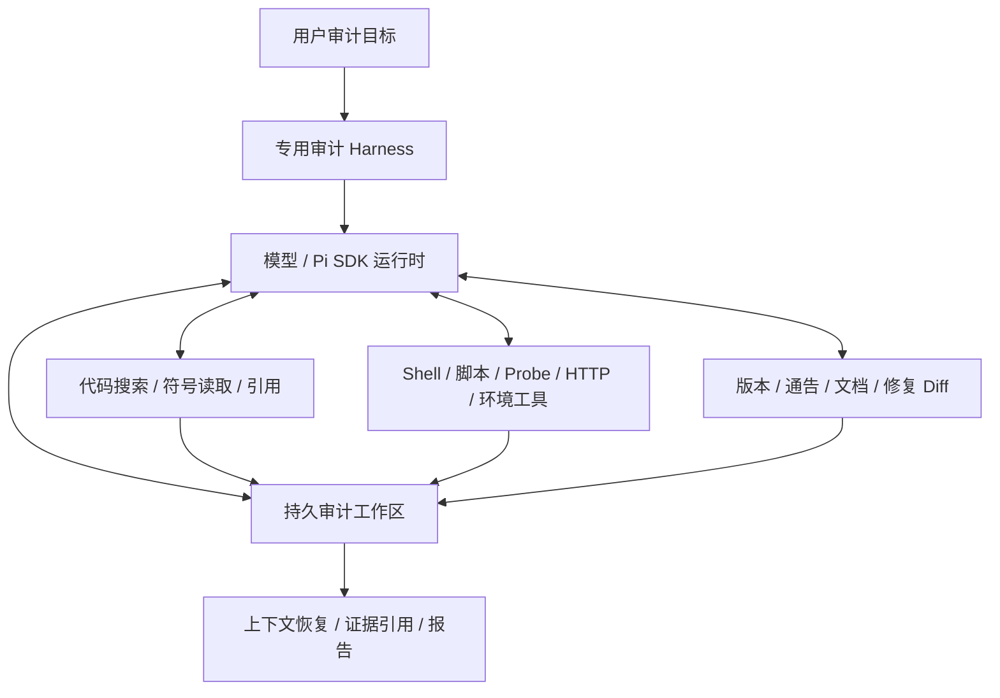

**专用代码审计 Harness：需求分析、技术选型与开发计划（修订版）**

调研日期：2026-10-29。本次修订依据用户明确的两项原则：开发专用代码审计 Harness；相信模型的分析与行动能力，围绕实际痛点补足工具和运行支持，避免过度限制与过度设计。项目现状事实沿用上一轮已核查的公开源码和官方文档，本轮没有重新进行候选运行时或审计效果实测。

**定位：让模型更顺畅地完成代码审计。** 项目拥有审计系统提示、上下文组织、工具交互、连续执行与恢复策略；这些构成专用 Harness 的核心。模型自主决定读哪里、追哪条链、如何搭环境、是否需要 PoC、怎样判断和报告。Harness 负责提供信息、执行动作、保存过程和延续任务。

**主线仍推荐 Pi SDK 起步，自研审计上下文、执行工具和持久工作区。** Pi 提供可复用的运行时基础，产品本身是一套完整的专用审计 Harness。优先使用 SDK 和扩展；若真实审计证明某个必要能力只能局部修改运行时，就做有回归保障的定向修改，不为维持“零 fork”叠加复杂封装。

**一、相对上一版的修改**

| 上一版安排 | 修订后安排 | 修改理由 |
|---|---|---|
| 把权限控制、工具限制、隔离执行列为主要架构前提 | 默认保留 shell、脚本、依赖安装、文件和网络工具；容器按实验需要调用 | 原始痛点主要是做事不顺，而非模型权限过大 |
| 先建设严密的证据状态与导出门禁 | 自动保存工具输入输出，模型随时记候选、反证和结论；导出提供引用和一致性提醒 | 节省模型记录劳动，不让填表和状态流转阻塞分析 |
| 以“不改上游、限制内置工具”为选型验收重点 | 以读代码、写 probe、跑实验、查补丁和恢复任务是否顺畅验收 | 选型服从专用审计体验 |
| 第一版之后投入大型框架关系与图查询 | 首版做好符号、引用、补丁和关联搜索；语义图按实际卡点逐步接入 | 相信模型能从高质量片段与查询结果重建链路 |
| 第 6 周交付 Django MVP，第 13 周再完成 Java | 先交付 Python/Java 都能使用的通用执行与代码工具；专项环境模板随后补 | 产品定位是代码审计 Harness，Django/Struts 是验证案例和适配方向 |
| 较多预设“禁止”“必须证明”“不得继续” | 提供完整事实、失败原因和下一步可用操作，模型决定如何继续 | 将判断留给模型，将机械劳动交给工具 |
| 预设 40%/30% 等改善门槛 | 先建立实际基线，报告耗时、重复读取、工具失败和有效发现的变化 | 当前材料不足以支持这些百分比作为发布门槛 |

保留超时、取消、进程清理、原始日志、源码版本和上下文恢复。这些直接处理复盘中的挂起、端口残留、输出截断和重复劳动；参数可调整、过程可继续，不扩展为权限审批或通用治理体系。

**二、三份需求的共同点与差异**

第一份 Java/Struts 复盘记为 A，第二份 Django 复盘记为 B，第三份强调事实与推测的 Django 复盘记为 C。原文路径与哈希见同目录《调研来源与版本快照.json》。

| 主题 | A：Java/Struts | B：Django 审计链路 | C：Django 复核与稳定性 | Harness 应提供什么 |
|---|---|---|---|---|
| 代码导航 | 大文件整读，手追调用链 | 漏掉 `pre_save` 等隐式入口 | grep 噪声，定义/引用/descriptor 缺失 | outline、按符号读、定义/引用、关联搜索；需要时补框架关系 |
| 实验执行 | classpath、mock、value stack、多轮编译 | GDAL/GEOS/PostGIS、迁移、服务与代理 | 缺依赖，payload 和 shell/工具故障 | 便捷的脚本/probe 执行，环境诊断、服务管理、结果保存 |
| 外部事实 | 版本 → 通告 → 修复 diff 是最大卡点 | 修复范围旁路，预写发布说明混淆 | 文档和测试影响信任边界判断 | 通告、文档、测试、git diff 的统一检索与缓存 |
| 长任务记忆 | 重复整文件读取 | 多条链和长报告挤占上下文 | 压缩后重查，故障后丢状态 | 持久审计笔记、候选、已排除思路、实验结果和下一步 |
| 输出成果 | 版本命中与复现描述混淆 | 报告、README、lab 三处更新 | stock/shim/simulated 的区别需要解释 | 自动留存来源与运行事实，帮助模型引用与修订报告 |

最核心的需求是：**更快找到相关代码，更快把想法跑起来，更容易获取版本与修复事实，长时间工作仍能保持进展。**

B、C 可能来自同一次或高度重叠的审计，不能算作两次独立验证。复盘中的耗时、CVE、版本与严重性没有在本次重新复现。B、C 对部分路径的安全定性也有分歧：Harness 应将文档、代码和实验结果及时交给模型，并保存模型当前判断及理由；不据此开发自动漏洞裁判。

**三、功能范围与优先级**

| 能力 | 第一版做什么 | 暂不做什么 |
|---|---|---|
| 审计 Agent 与上下文 | 审计系统提示、任务启动/继续、可更新的审计摘要、候选与下一步；工具结果按需展开 | 强制按固定审计阶段执行、固定 checklist 才能结束 |
| 代码阅读 | 分页搜索、目录摘要、outline、按类/方法/函数读；默认聚焦源码，随时查测试/产物/依赖 | 自研全语言静态分析引擎 |
| 动态执行 | 保留 shell；增加结构化 argv、stdin、文件输入与脚本运行；编译/运行 probe、后台服务、取日志、取消与继续 | 为每类实验先定义 DSL，或要求只能调用专用 runner |
| 环境支持 | 识别 Python/JDK/构建工具、帮助解析依赖和 classpath；模型可以自行安装与修复环境 | 所有项目都要先容器化或完整构建 |
| 版本与补丁 | 本地 git、官方通告/文档、发布信息和 diff 查询；保留来源和抓取时间 | 先做全量 CVE 镜像、向量库或复杂知识图谱 |
| 审计工作区 | 自动保存工具运行；模型用轻量接口记录候选、反证、结果和下一步；支持附件与报告引用 | 完整工单系统、繁复状态机、每轮强制填表 |
| 框架模板 | 按实际摩擦补 Django 项目骨架、PostGIS/GDAL 环境和 Java probe/classpath 模板 | 把 Django、Struts 的每种入口编码成产品流程 |
| 语义分析增强 | 对模型难找的隐式入口补定义/引用、框架关系或调用查询；接现成工具 | 默认承诺找全所有入口或完整污点路径 |
| 成果输出 | 模型写报告，工具帮助带入代码片段、运行结果和来源链接；保留可编辑性 | 确定性生成全部结论、以规则限制严重性或阻止导出 |

多 Agent、fuzz、反编译等不作为第一版的独立工程，但也不人为禁止：已有工具能用、模型认为有帮助时可调用。是否专门建设取决于后续审计是否经常因此受阻。

**四、候选项目现状与技术选型**

以下事实以上一轮 2026-10-29 的读取结果为准；源码版本字段不等于 npm latest，文档也不构成实际性能证明。

| 候选 | 核实到的项目事实 | 对本项目的意义与限制 |
|---|---|---|
| DSH | 官方项目为 `deepseek-ai/deepseek-harness`，Cordis 插件架构；工具注册与执行前后流水线有文档；README 明示 developer preview 和破坏性变更。读取到的根包版本为 `0.2.2-alpha.2` | 能在插件层增加工具、调整执行与上下文、收集结果，并复用 Web 界面；专用审计运行逻辑仍需开发，平台 API 迁移成本需预算。依据：[官方仓库](https://github.com/deepseek-ai/deepseek-harness)、[工具作者接口](https://github.com/deepseek-ai/deepseek-harness/blob/master/docs/cookbook/adding-a-tool.md)、[执行流水线](https://github.com/deepseek-ai/deepseek-harness/blob/master/docs/tool-execution-pipeline.md) |
| Grok Build | 已公开 Rust CLI/TUI 与运行时，支持 headless、ACP、MCP、hooks、plugins 和自定义模型端点；代码从内部单仓定期同步，根目录有 `SOURCE_REV`；README 表示不接受外部贡献；自有代码 Apache-2.0 | 可以扩展，不能再按“闭源产品”排除；但深度 fork 的长期变更更难回流，上游同步与构建成本对小团队不利。依据：[官方开源公告](https://x.ai/news/grok-build-open-source)、[仓库说明](https://github.com/xai-org/grok-build)、[自定义模型](https://github.com/xai-org/grok-build/blob/main/crates/codegen/xai-grok-pager/docs/user-guide/11-custom-models.md) |
| Codex CLI | 官方明确开放 CLI、app-server、SDK；app-server 提供会话、事件、中断、审批等集成；`dynamicTools` 仍标记 experimental；可通过 MCP 接入业务工具 | 很适合作为现有 Codex 用户的集成入口；不需要修改 Rust 核心即可接审计服务。审计专用的上下文组织与连续执行策略，要验证公开协议能支持到什么程度。依据：[官方平台说明](https://developers.openai.com/blog/codex-as-a-platform)、[app-server](https://learn.chatgpt.com/docs/app-server) |
| Pi | 官方当前仓库为 `earendil-works/pi`；源码中的 coding-agent 包为 `1.4.0`；TypeScript SDK 可替换工具、资源加载、状态服务，支持事件、持久化会话与压缩；CLI 当前已有 MCP 扩展，SDK 需显式接入；MIT | 适合复用运行时并自主设计审计上下文、工具和会话。没有内置权限隔离，但本项目不将权限治理作为首版选型前提；按实验需要使用容器即可。依据：[SDK](https://pi.dev/docs/latest/sdk)、[MCP](https://pi.dev/docs/latest/mcp)、[权限说明](https://github.com/earendil-works/pi#permissions--containerization)、[固定源码包](https://github.com/earendil-works/pi/blob/67c63c0f7ff41a55176683b0f55bbd8fb0f4935e/packages/coding-agent/package.json) |
| OpenCode | 当前官方项目为 `anomalyco/opencode`；提供 headless HTTP server、OpenAPI/SDK、插件、MCP、工具前后 hooks、LSP 集成；MIT；读取到 dev 分支根包版本 `2.2.0` | 快速接完整编码工作台很合适；审计台账、实验语义、框架路径仍需自建。内置 LSP 不代表已经有审计污点图。依据：[Server](https://opencode.ai/docs/server/)、[Plugins](https://opencode.ai/docs/plugins/)、[LSP](https://opencode.ai/docs/lsp/)、[仓库](https://github.com/anomalyco/opencode) |

还需要纠正两类容易过时的判断：当前 Pi 已有 MCP 支持；Grok Build 已开源且可接自定义模型，不能以“只能使用 Grok”否决。Codex 也支持自定义 provider，但当前配置文档中的自定义 `wire_api` 只列出 `responses`，接任意供应商仍需验证协议与工具调用兼容性。[Codex 配置参考](https://learn.chatgpt.com/docs/config-file/config-reference)

**在修订后的定位下如何比较**

下表是针对本项目的工程判断。选型重点为：能否便捷嵌入审计工具，能否调整上下文与连续执行，是否容易维护，以及有多少无关产品能力需要承接。

| 路线 | 架构与扩展性 | 开发与维护成本 | 修订后判断 |
|---|---|---|---|
| 完全从零开发 | 自由度最高，自行实现 loop、模型适配、会话和压缩 | 最高；大量工作不直接解决审计痛点 | 自研专用 Harness 的策略与工具，复用底层运行时更划算 |
| DSH | 插件可组合工具、执行与上下文，能复用 Web 界面 | 启动成本低至中；有 Cordis 和预览 API 的学习/迁移成本 | 有力备选；团队熟悉 DSH 或需要现成 Web 交互时优先级上升 |
| Grok Build | 工具、hooks、plugins 与完整终端运行时可用 | 外挂中，深改高；Rust 构建与内部同步增加维护工作 | 可接审计工具；当前不优先承接完整源码产品 |
| Codex CLI/app-server | 会话和工具接入方便；专用上下文与 loop 调整受公开接口影响 | 外围集成低，深改高 | 面向 Codex 用户的专用 Harness 可选；先验证所需接口 |
| Pi SDK | 直接嵌入，工具、上下文和资源扩展适合做专用运行体验 | 中；可较少承接完整产品界面，仍需维护升级兼容 | 继续推荐；不因缺权限系统增加额外首版工程 |
| OpenCode | Server/SDK、插件、MCP、LSP，复用客户端方便 | 低至中；深入改上下文/执行时需适配完整产品行为 | 现成客户端优先时有竞争力，当前不是主要诉求 |

**推荐保持 Pi SDK 起步，但理由和实施方式改变。** 它帮助我们复用模型交互、会话与事件，把精力放在专用审计上下文、代码工具和实验执行上。开发的核心是模型与审计环境如何协同，不只是给现成聊天界面增加几个 MCP 工具。[Pi SDK](https://pi.dev/docs/latest/sdk)

先用 coding-agent SDK 能满足需求的能力；当真实用例暴露关键缺口，再决定局部修改或使用更底层组件。不要因为可能出现缺口提前重写 loop，也不要因为“不能 fork”而对必要改动设障碍。DSH/OpenCode 提供的权限机制不再是加分重点，Pi 缺少权限系统也不再是本项目的主要缺点。

第一版只实现一个运行时。代码工具、执行和持久工作区保持清楚的接口即可，不先建设多运行时抽象层；MCP 对外适配以后按需求补。

**五、最小架构与交互原则**

第一版使用一个 TypeScript 项目、本地文件和必要时的 SQLite。自动日志先用 JSONL、输出与脚本作为文件保存；候选查询与引用关系确有需要时再加 SQLite，不做重复数据层。Python/Java 工具作为子进程接入。容器是可选执行后端和环境模板，按实验需要使用。

**给模型的工具应当让能力互补：**

- 保留普通读写与 shell，模型可自由写脚本、补依赖、调用外部分析器和修改 PoC。
- 提供更省事的专用入口，例如 `read_symbol`、`find_references`、`lookup_fix`、`run_probe`、`start_service`、`read_artifact`，让常见劳动不必每次重写。
- `run_probe` 接收普通 Python/Java/脚本文件、参数和环境配置，不先发明覆盖所有场景的 probe DSL。HTTP 请求可接受原始字节或文件，避免 payload 被 shell 改写。
- 代码搜索和日志默认给摘要与相关片段，同时给继续展开的方法；模型可以看完整内容、扩大范围和改变搜索方式，避免把预算配置变成分析障碍。
- 外部工具有结果就返回结果，有失败就返回退出原因、相关日志和可继续操作的句柄；模型决定换方案、安装依赖、重试或放下当前假设。
- 长任务可查询进度、调整等待、主动取消和重启。保留服务/worker/端口信息，恢复时告诉模型哪些工作还活着，不把“绝不重试”写成全局禁令。

Tree-sitter、Jedi 或 LSP 可减少机械定位工作，但不必替代模型对代码的推理。Tree-sitter 主要提供语法树；Jedi 提供定义、推断和引用 API。先接真实会用到的功能。[Tree-sitter](https://tree-sitter.github.io/tree-sitter/)、[Jedi API](https://jedi.readthedocs.io/en/latest/docs/api.html)

**工作区以帮助记忆为目的：**

最少保留审计目标与版本、当前摘要、候选与已排除思路、实验脚本与运行结果、来源引用和下一步。工具日志自动记录；模型在重要进展时更新摘要或笔记，无需每轮填写规定字段。

运行记录自动带源码版本、命令、环境和原始输出。模型可补充 stock/shim/simulated、前置条件和结论；这些是便于判断的信息，不设置“获得某标签才能继续”的关卡。源码变化时提示旧引用对应哪个版本，报告仍由模型组织与修订。

对矛盾和缺失可以给出非阻塞提醒，例如“此结论引用的源码版本已变化”“这次实验用了 shim”，并附可直接查看的事实。不自动裁定漏洞是否成立，不对严重性设硬门禁，不把完成报告变成一套审批流程。

**上下文管理是专用 Harness 的核心投入之一：**

会话恢复时优先带回审计目标、当前代码地图、候选与反证、关键实验结果和下一步。原始输出按 ID 随时取回。摘要用于延续推理，原始代码/实验仍可重读；失败实验也留下，避免模型因压缩丢掉已经排除的路线。系统提示只提供必要的审计背景、工具使用方式和持久工作区约定，避免塞入大段重复 checklist。

**六、精简后的开发计划**

假设两名熟悉 TypeScript/Python 的工程师：**约 4–6 周交付可实际审计的第一版，之后以 2–4 周迭代补专项能力。** 这是缩小范围后的工程估算，不是对同一套旧需求承诺更快完成。完整框架图、权限治理、强制报告校验和大型 UI 已从首版移除。

| 阶段 | 目标与核心功能 | 验收标准 |
|---|---|---|
| 0：2–3 天，验证最短链路 | Pi SDK 启动专用审计会话，读真实源码、写并运行一个脚本、取回结果、重启继续；确定持久工作区约定 | 模型可自主组合通用与专用工具；不改核心也能完成最短链；断开后能知道已做什么和接下来做什么 |
| 1：第 1–2 周，先减少阅读与执行摩擦 | 源码摘要、分页搜索、按符号读；shell + 结构化脚本/参数执行；长输出文件；后台服务、端口、日志和取消；自动运行记录 | 模型可在 Python、Java 案例中自行写实验；特殊字符不被改写；长输出不丢且能展开；服务可启动、查询、停止；失败有可诊断信息 |
| 2：第 3–4 周，接通审计事实与长任务 | 版本/通告/官方文档/git diff 查询；候选笔记与引用；工作摘要、反证和未完成实验的恢复；模型编写报告 | 可沿“版本 → 修复 → 相关代码”继续分析；网络失败有缓存或错误事实；压缩/重启后能继续同一候选；报告能引用真实代码和运行结果 |
| 3：第 5–6 周，用真实审计打磨首版 | 在 Django 与 Struts 案例或等价目标中试用，按轨迹补最耗时的工具；可补定义/引用、classpath 或最小项目模板 | 两类目标都完成一次从代码分析、实验到报告的闭环；记录剩余卡点；工具不要求固定审计顺序，也不要求完整图或模板才可工作 |
| 后续：每轮 2–4 周，按卡点增强 | 在实际反复受阻处选择补框架隐式关系、Fix-Scope、GDAL/PostGIS profile、反编译器、真实容器或其他工具 | 对选中的卡点做同任务前后对比，确认减少人工追链或环境劳动，再决定是否继续扩展 |

阶段 1–3 一起构成首版。第 3–4 周即可开始使用；第 5–6 周用于真实用例打磨，不等待一个“大而全”的能力集齐。

不预先排定“先把 Django 图做完，再适配 Java”；也不把 Java 支持等同于已完成全套 Struts 框架建模。首版支持模型用 Java 工具工作，专项模板再按反复出现的摩擦建设。

三份复盘没有附原始 probe、目标源码和完整执行轨迹。能找到对应资产就重放；暂时找不到时用明确标注的等价目标/fixture 做工程验收，不把工程跑通写成原漏洞复现。

**七、如何衡量价值**

保留评测，但让它服务迭代。初期记录：定位相关代码用时、假设到实验结果用时、环境排错轮数、工具异常、重复读取、上下文恢复后的返工、有效发现及误报。使用同模型和相近条件比较工具加入前后；不能控制的差异写清楚。

不先要求达到任意百分比才能发布，也不把小样本包装成发现率证明。更直接的首版判断是：模型是否能连续工作，是否减少工具用法和环境排错，是否不用反复重读已经掌握的事实，以及是否更容易把值得验证的想法跑出来。

工程回归聚焦实际失败：特殊字符、长输出、挂起、后台任务、版本混淆、会话恢复。遇到一次可重现的工具问题，就为它保留一个回归案例。模型判断的质量通过实际审计结果评估，不用大量固定流程代替模型推理。

**八、来源快照与仍待验证的信息**

本次通过 GitHub API 读取到的默认分支 commit：

| 项目 | 分支 | 观察到的 commit |
|---|---|---|
| DSH | master | `f3803c96974ad4a94195fb97e5c637e9c2a3afe3` |
| Grok Build | main | `2bdd1d6a6369de0e8c68132ea4539e9abd9e14a8` |
| Pi | main | `67c63c0f7ff41a55176683b0f55bbd8fb0f4935e` |
| OpenCode | dev | `510aa79d075c32e75f85b7774ff7390370c22b18` |

Codex 本次核查的是官方文档接口，没有固定二进制版本；阶段 0 若接入需另行冻结。其他项目的默认分支快照也不是生产版本推荐。发布前按选定 release/commit 重跑兼容测试并审阅许可证与第三方依赖。

尚未实测哪个运行时的审计发现能力更强、同模型下谁更省 token，也没有证明某种语义索引必然提高漏洞召回率。Pi 推荐依据是当前接口与本项目实现边界；首轮真实审计后可以调整。

本次修订后的开发重心是：**专用审计上下文、顺手的代码与实验工具、版本/修复检索、能延续工作的持久记忆。** 业务判断和探索路径交给模型，工具负责把信息与行动接通。
